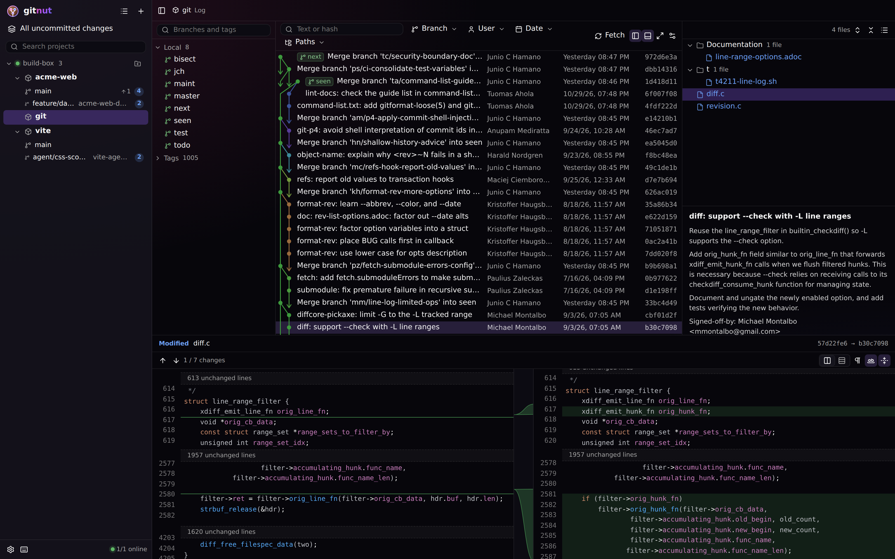
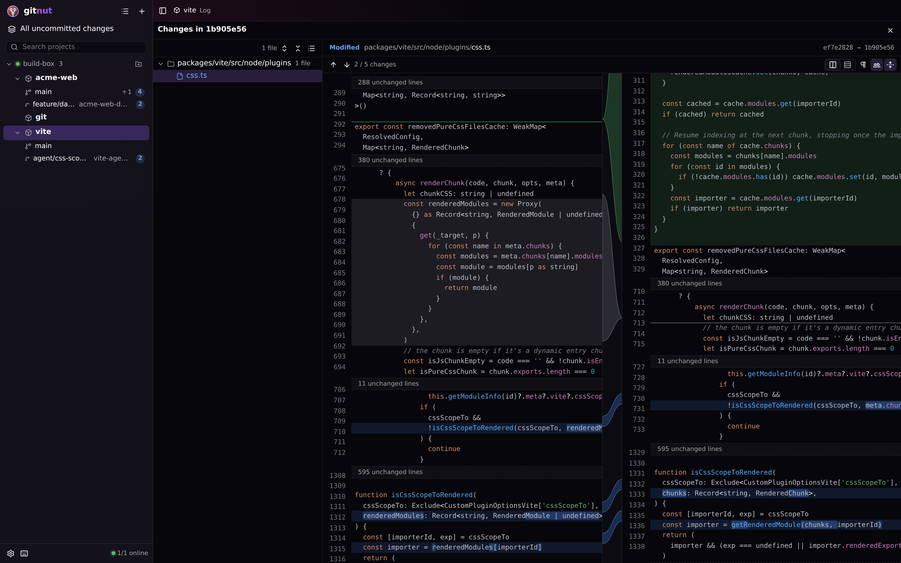
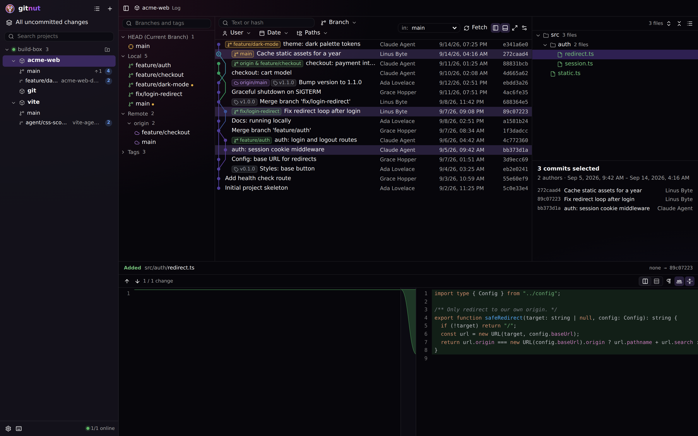
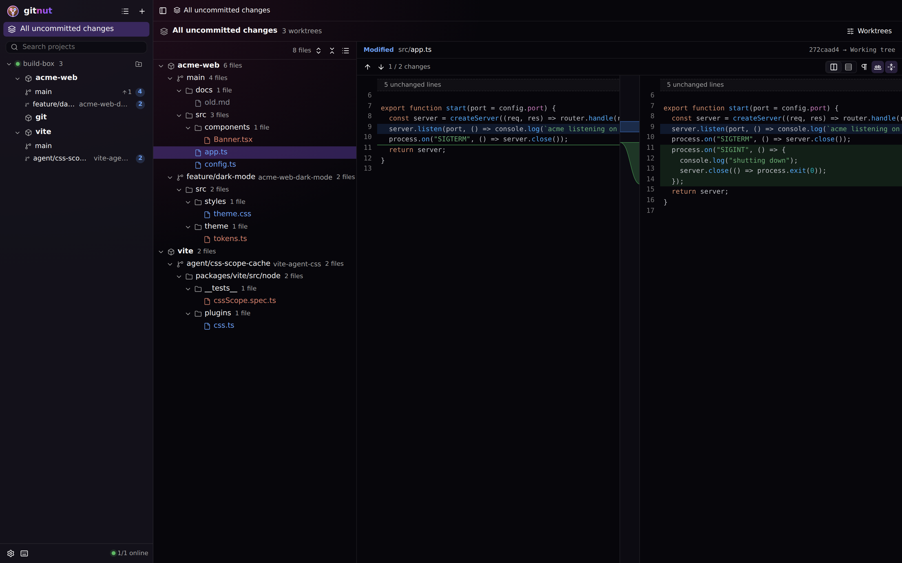
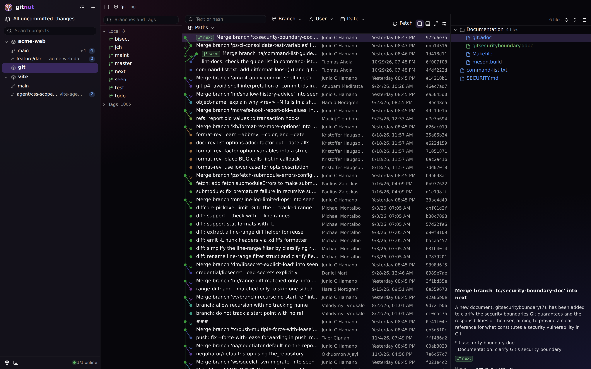
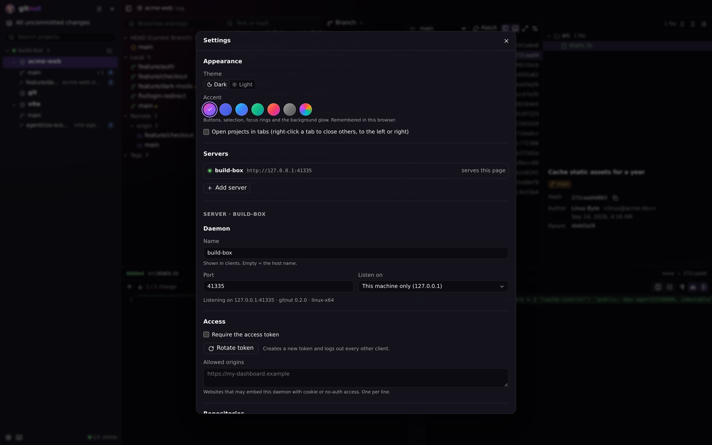
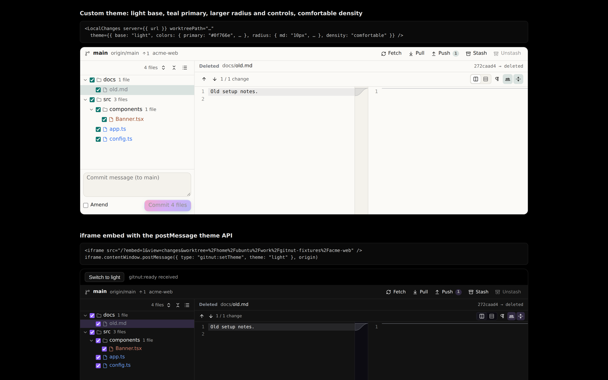
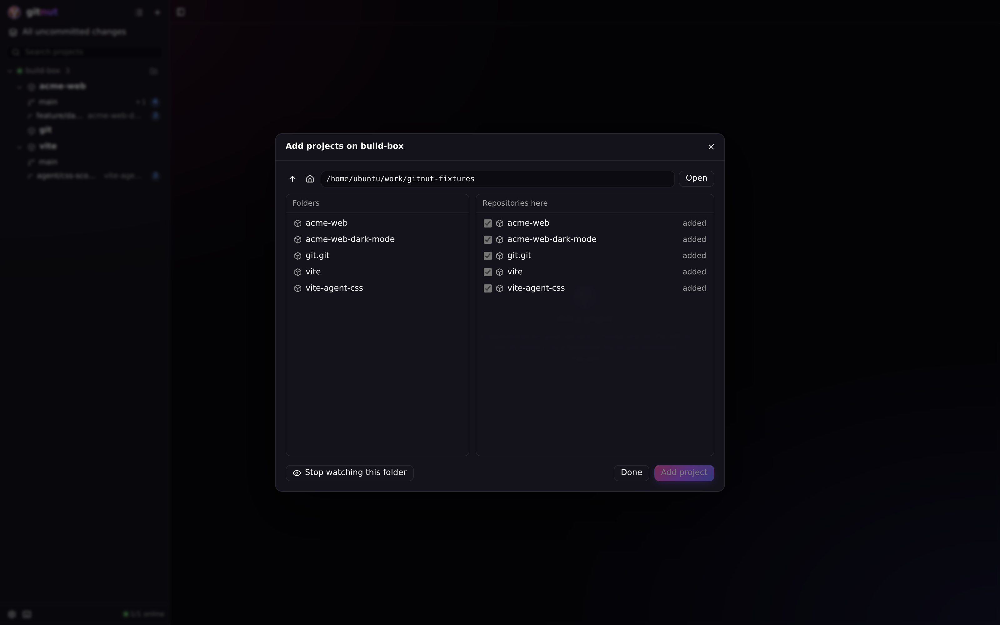
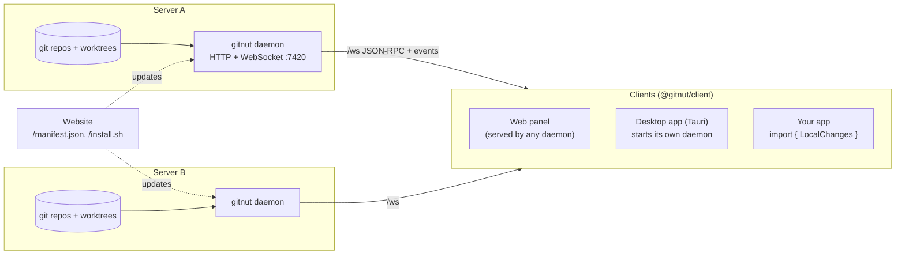

<div align="center">
  
  <h1>GitNut</h1>
  <p><b>A remote-first git client with IntelliJ's log graph and diff viewer.</b><br/>
  One daemon per machine, one client for all of them: web panel, desktop app, or React components inside your own app.</p>
  <p><a href="https://gitnut.dev">gitnut.dev</a> · <a href="https://gitnut.dev/changelog">Changelog</a> · <a href="https://github.com/flyingart/gitnut/releases">Downloads</a></p>
  <p><a href="https://github.com/flyingart/gitnut/actions/workflows/ci.yml"></a></p>
</div>



GitNut is built for watching AI agents work: many repositories, many worktrees, several
servers. Every machine runs a small `gitnut` daemon that pushes its git state over WebSocket.
The client connects to any number of daemons and shows every project in one place, with the
commit graph, changes tree and diff of IntelliJ IDEA's git client (ported from its Apache-2.0
source), in a modern dark glass UI.

## Contents

- [Features](#features)
- [Quick start](#quick-start)
- [Architecture](#architecture)
- [Daemon and CLI](#daemon-and-cli)
- [Security](#security)
- [Embedding: React SDK and iframe](#embedding-react-sdk-and-iframe)
- [Updates](#updates)
- [Development](#development)
- [Build and release](#build-and-release)
- [Desktop apps (macOS, Windows, Linux)](#desktop-apps-macos-windows-linux)
- [Tests](#tests)
- [Contributing](#contributing)
- [License](#license)

## Features

- **One graph with every branch.** Local, remote and tag refs in one IntelliJ-style graph: same
  lane layout, branch colours, IntelliSort ordering and long-edge arrows (click an arrow to
  jump to its commit). Smooth with 80k+ commits.
- **Multi-select = combined changes.** Ctrl/Cmd+click or Shift+click any commits, also
  non-adjacent ones. For each file, the diff runs from before the first selected commit that
  touched it to after the last one (IntelliJ `zipChanges` semantics; renames chain).
- **IntelliJ diff viewer.** Side-by-side or unified, syntax highlighting, word-level changes,
  curved connector bands between the panes, collapsed unchanged blocks, ignore whitespace,
  F7 / Shift+F7 through all changes of all files. Images (png, jpg, gif, webp, ...) show
  before / after side by side.
- **Changes tree.** Nested by folder with single-child folders compacted
  (`src/main/kotlin`), file counts and IntelliJ status colours, or a flat list.
- **Live agent monitoring.** Uncommitted changes of every worktree (T3 Code, Jean, plain
  `git worktree`) update live. "All uncommitted changes" combines several repos and worktrees into
  one tree.
- **Simple controls.** Commit selected files (with amend), fetch, pull, push.
- **Many servers.** Projects grouped by server, or one flat list.
- **Everything is a component.** `LocalChanges`, `CommitGraph`, `DiffViewer`, ... work alone in
  any React app, fully themable (colours, radius, control sizes, spacing, fonts, glass).
- **Self-updating.** `gitnut update` or the update button in the client updates the daemon,
  and with it the web client it serves.

| | |
|---|---|
|  |  |
| Side-by-side diff with connectors | Combined changes of several commits |
|  |  |
| Live uncommitted changes across worktrees | Flat projects list |
|  |  |
| Daemon settings from the client | Standalone components and iframe embed |
|  | |
| Add single projects or watch a whole folder | |

## Quick start

On every machine whose repositories you want to see:

```sh
curl -fsSL https://gitnut.dev/install.sh | sh     # Linux / macOS
# irm https://gitnut.dev/install.ps1 | iex        # Windows (PowerShell)

gitnut service install             # systemd user unit / launchd agent, starts now and at login
gitnut status                      # running (pid …) at http://127.0.0.1:7420
```

Open the printed URL. Out of the box the daemon listens on `127.0.0.1` with auth off, so on
your own machine there is nothing to log in to. Add projects in the client (**+** →
**Add projects…**): browse the machine's folders, then tick single repositories or **Watch
whole folder** so every repo in it, also future ones, shows up. Hover a project and click the
eye icon to hide it again. The CLI does the same:

```sh
gitnut repos add ~/code/one-repo    # one project
gitnut roots add ~/projects         # a whole folder (scanned to scanDepth, default 3)
gitnut repos remove ~/projects/x    # hide one repo of a watched folder
```

To reach the daemon from other machines (other servers, your laptop over Tailscale), turn auth
on and bind it to the network:

```sh
gitnut config set auth.enabled true
gitnut config set bind tailscale   # localhost (default) | tailscale | all | <ip>
gitnut token                       # paste this in the client's login form
```

Then click **+** → **Add server…** in your client and enter each daemon's URL and token. Or
install the desktop app: it starts its own daemon and logs in automatically.

From source (no installer):

```sh
bun install
bun run scripts/build-daemon.ts --targets host --build-web   # -> dist/bin/gitnut-<platform>
./dist/bin/gitnut-linux-x64 serve
```

## Architecture



Monorepo (bun workspaces):

| Package | What it is |
|---|---|
| `packages/commons` | Shared code: wire protocol types (`protocol.ts`), settings, platforms/assets, the **IntelliJ graph port** (`graph/`: permanent graph, IntelliSort, layout, filtered graph, print elements, painter, colours) and `zipChanges` (`changes/`). |
| `packages/daemon` | The `gitnut` binary: daemon + CLI. Bun, no runtime dependencies. Runs `git` and parses its output, polls what clients subscribe to, serves the web client. |
| `packages/client` | `@gitnut/client`, the React SDK: connection layer, hooks and every UI component. Plain CSS scoped under `.gitnut-root`. |
| `packages/web` | Vite app rendering `<GitnutApp/>`, embedded into the daemon binary. Also `/examples.html`. |
| `packages/desktop` | Tauri v2 shell. Bundles the daemon as a sidecar and starts it with the app. |
| `packages/site` | Landing page with platform detection, update manifest, install scripts, download redirects. Configured by env vars; Dockerfile for Coolify. |
| `scripts/` | `build-daemon.ts`, `build-desktop.ts`, `release.ts`, `dev.ts`, `screenshots.ts`, `demo-repo.ts`. |

**Protocol.** One WebSocket per server at `/ws`. Client → server: `{id, method, params}`;
server → client: `{id, result | error}` or `{event, data}`. Methods and events are typed in
[`packages/commons/src/protocol.ts`](packages/commons/src/protocol.ts): `repos.list`,
`repos.add|remove`, `roots.add|remove`, `fs.browse`, `repos.discover`,
`graph.get` (the whole graph as compact parent-index arrays), `graph.details` (subjects/authors
for visible rows only), `graph.filter`, `commits.changes`, `worktree.status`, `file.diff`,
`worktree.commit|pull|push`, `repo.fetch`, `settings.*`, `update.*`, `subscribe`.
Live updates: clients subscribe to `repos`, `repo:<id>`, `worktree:<id>`. The daemon polls
only those (refs and `git status` with `GIT_OPTIONAL_LOCKS=0`, so it never takes locks agents
need) every `pollIntervalMs` and pushes `graph.changed` / `worktree.changed` /
`repos.changed` when something changes.

**Graph.** Like IntelliJ: the daemon sends the structure once (ints, about 1 MB for 50k
commits). The client builds the layout (about 0.3 s for git.git's 86k commits), computes print
elements only for visible rows and paints them on a canvas with the ported IntelliJ painter.
Commit details load per visible range.

## Daemon and CLI

```
gitnut serve [--port N] [--bind localhost|tailscale|all|<ip>] [--no-web] [--force]
gitnut status [--json]                 # {running, url, version, name, pid}
gitnut stop
gitnut config get [key]                # e.g. gitnut config get auth.enabled
gitnut config set <key> <value> [--force]
gitnut token [--rotate]
gitnut repos list|add <path>|remove <path>
gitnut roots list|add <dir>|remove <dir>
gitnut update [--check]
gitnut service install|uninstall|status
gitnut version
```

Settings live in `~/.gitnut/config.json` (`GITNUT_HOME` or `--home` to change). When a daemon is
running, `config set` goes through its API, so changes apply at once (port / bind / serveWeb
restart the listener). The same settings are editable in the client (gear icon).

| Key | Default | Meaning |
|---|---|---|
| `name` | hostname | Server name shown in clients |
| `port` | `7420` | HTTP + WebSocket port |
| `bind` | `localhost` | `localhost`, `tailscale` (this machine's Tailscale IPv4), `all` (0.0.0.0) or an IP |
| `auth.enabled` | `false` | Token auth on/off. Turn it on before binding beyond localhost |
| `serveWeb` | `true` | Serve the web client at `/` (`--no-web` for one run) |
| `roots` | `[]` | Watched folders: every repo under them shows up, down to `scanDepth` (default 3) |
| `repos` | `[]` | Single projects added one by one |
| `exclude` | `["node_modules"]` | Folder names or path prefixes to skip (hidden repos of watched folders land here) |
| `pollIntervalMs` | `2000` | Live update interval for subscribed repos/worktrees |
| `hideInternalRefs` | `true` | Leave refs outside `refs/heads`, `refs/remotes`, `refs/tags` out of the graph. Agent tools keep checkpoint commits there (Jean `refs/jean/checkpoints/*`, T3 Code `refs/t3/*`) |
| `allowedOrigins` | `[]` | Extra browser origins allowed to use cookie / no-auth access (embedding) |
| `update.autoCheck` | `true` | Check at start and every 6 h, show the update button |

Worktrees are grouped under their main repository (same git common dir), including worktrees
outside the roots (for example worktrees that agent tools keep in their own folders).

## Security

The daemon can run `git commit`, `push` and `pull` on your machine, and `git` runs hooks. Treat
access to it like shell access.

- **Defaults: `127.0.0.1` and auth off**, for convenience on your own machine. Browsers are
  still held back by the Origin check below, but any local process or other local user can use
  the port. Turn auth on (`gitnut config set auth.enabled true`) on shared machines and before
  binding to `tailscale`, `all` or an IP; the CLI warns when auth is off on such a bind.
- **Auth is token only.** The token (32 random bytes) is in `config.json` (mode
  0600) from the first start, ready for when auth is turned on. Browsers log in with the token form or a `/?token=…` link and get an HttpOnly,
  SameSite=Strict cookie. SDK clients pass it as WebSocket subprotocol `gitnut.bearer.<token>`.
  Comparisons are constant-time. `gitnut token --rotate` disconnects every session that used
  the old token.
- **Origin and host checks.** Cookie and no-auth access only work from the daemon's own origin,
  `allowedOrigins` and the desktop app, so other websites can't drive a local daemon. They also
  need a host name a website can't point at your machine (IP addresses, `localhost`, the machine's
  own name, `*.local`, Tailscale `*.ts.net`, or a host in `allowedOrigins`), which stops DNS
  rebinding. Bearer-token access works from any origin (that is how embedding works).
- **Framing.** The web client may only be framed by the daemon's own pages and `allowedOrigins`.
  The health check (`/api/health`, open to any website) leaves out the machine's name for others.
- **Updates.** The update manifest is baked into the binary (`GITNUT_SITE_URL` at build time) and
  is not a setting, so no client can point a daemon at another binary. Downloads are checked against
  `SHA256SUMS`; desktop app updates are also signed with our updater key.
- **Exposure.** Turning auth off on a
  public bind (`all` or a non-Tailscale IP) is refused without `--force`. Exposing a daemon to
  the internet: keep auth on and put it behind HTTPS (a reverse proxy that sets
  `X-Forwarded-Proto: https` makes the cookie `Secure`).
- `file.diff` rejects paths that leave the worktree (`..`, symlinks).

## Embedding: React SDK and iframe

Every part of the UI is its own component. Each works alone with a `server` prop, or inside a
`GitnutProvider` that holds many servers. All accept `theme`, `className`, `classNames` (extra
classes per part) and `style`, plus their own options.

```tsx
import { LocalChanges } from "@gitnut/client";
import "@gitnut/client/styles.css";

// Only the live uncommitted changes of one worktree, next to your own UI:
<LocalChanges
  server={{ url: "http://100.101.102.103:7420", token }}
  worktreePath="/home/me/repo-worktree"
  showCommitPanel={false}
  mode="tree"            // fixes the option and hides its toggle; leave out to let the user choose
/>
```

```tsx
import { GitnutProvider, GitnutApp, CommitGraph, DiffViewer } from "@gitnut/client";

<GitnutProvider servers={[{ url: "https://gitnut.a.example", token: a }, { url: "http://100.1.2.3:7420", token: b }]}>
  <GitnutApp options={{ projectsGrouping: "flat" }} />
</GitnutProvider>
```

| Component | Shows |
|---|---|
| `GitnutApp` | The whole client (composition of the components below) |
| `GitnutProvider` | Connections to many servers (persisted in localStorage) and default theme |
| `ProjectsList`, `WorktreeList` | Servers, repos and worktrees (grouped or flat), branch, ahead/behind, dirty count |
| `LogView` | Branches panel + filter bar + graph + changes + details + diff preview |
| `CommitGraph`, `FilterBar`, `RefsList` | IntelliJ log table with canvas graph and multi-select, filters, branches panel |
| `CommitDetails` | Message, author, committer, hashes, refs (summary for several commits) |
| `ChangesTree`, `ChangesBrowser`, `DiffViewer` | Changes tree, tree + diff, the diff viewer alone (also with plain `before`/`after` text) |
| `LocalChanges`, `CombinedLocalChanges` | Live uncommitted changes of one worktree, or of many |
| `CommitPanel`, `GitActions` | Commit box, fetch/pull/push buttons |
| `AddProjectsDialog` | Browse a daemon's folders, add single repos or watch a whole folder |
| `SettingsPanel`, `AppearancePanel`, `ServersPanel`, `UpdateButton`, `LoginForm`, `AddServerDialog` | Daemon settings, theme and accent picker, the client's server list, update (`compact` = icon), token login, add a server |

Hooks for custom UIs: `useRepos`, `useWorktree`, `useGraph`, `useCommitDetails`,
`useCommitsChanges`, `useLocalChanges`, `useFileDiff`, `useSettings`, `useUpdate`,
`useViewOptions`, `useConnection`.

**Theme.** `theme` takes a partial `GitnutTheme` merged over `darkTheme` (default) or
`lightTheme` (`base: "light"`). Tokens map to `--gitnut-*` CSS variables: colours (surfaces,
text, primary, status colours per change type, diff colours, ref colours, syntax colours),
`graphPalette`, `radius`, `controlHeight`, `space`, `font`, `fontSize`, `rowHeight`, `glass`
(blur, opacity, saturation), `density` (`compact` / `comfortable`). `colors.gradient` paints
primary buttons and highlights; `colors.backdrop` is the app background behind the glass panels.

**Accents.** `accentTheme(accent, scheme)` builds the primary colour, gradient and backdrop from a
preset (`ACCENTS`: `coconut` (default, pink → violet → blue), `t3`, `ocean`, `emerald`, `sunset`,
`mono`) or any CSS colour. `GitnutApp` without a `theme` prop uses the user's choice from
Settings → Appearance (view options `scheme`, `accent`); a host `theme` hides that picker.

```tsx
<CommitGraph repoId={id} server={srv}
  theme={{ base: "light", colors: { primary: "#0f766e" }, radius: { md: "10px" }, density: "comfortable" }}
  classNames={{ toolbar: "my-toolbar", row: "my-row" }} />
```

**iframe.** Any daemon's web client embeds too:
`<iframe src="https://host:7420/?embed=1&view=changes&worktree=/path/to/wt#token=…">`.
URL params: `embed=1`, `theme=<dark|light|json>`, `server=<url>` (+ `#token=`),
`view=log|changes|all-changes`, `repo=<id|path|name>`, `worktree=<path>`, `options=<json>`.
postMessage in: `{type: "gitnut:setTheme", theme}`, `{type: "gitnut:setOptions", options}`; out:
`{type: "gitnut:ready"}`. The origin of the host page must be in `allowedOrigins` unless the
token is passed in the URL hash. Live examples: `/examples.html` on any daemon.

## Updates

1. `bun run release` (start, build on each machine, publish) creates the GitHub release; the website
   reads GitHub releases, so its `/manifest.json` offers the new version within 10 minutes.
2. Daemons check `<GITNUT_SITE_URL>/manifest.json` (baked in at build time; `GITNUT_MANIFEST_URL` in the
   daemon's environment overrides it for mirrors and tests). An update icon shows next to the logo.
   `gitnut update` or that icon downloads the binary for the platform, verifies its SHA-256,
   replaces the executable and restarts it (a service is restarted by systemd/launchd, otherwise
   the new binary starts itself). The daemon serves the web client, so it updates with it.
3. Inside the desktop app the same icon and button update the whole app (Tauri updater, signed by
   our key, checked every 10 minutes); its new bundled daemon replaces the old one, so app, daemon and
   web client always match. Settings show the versions at the bottom.

## Development

```sh
bun install
bun run dev          # daemon (watch) + web (Vite, :5174) + site (:7431), prints the URLs
```

- Web client only: `bun run --cwd packages/web dev` (proxies `/ws` + `/api` to
  `GITNUT_DEV_DAEMON`, default `http://127.0.0.1:7421`).
- Daemon only: `GITNUT_HOME=.cache/dev-home bun packages/daemon/src/cli.ts serve --port 7421 --bind all`.
- Demo data: `bun run scripts/demo-repo.ts` (repo with branches, merges, tags, a remote, a second
  worktree and uncommitted edits).
- Screenshots for this README: `bun run screenshots` (open-source fixture repos only).
- `bun run typecheck` checks every package.

## Build and release

Details (all env vars, Coolify setup for the site): [docs/BUILD.md](docs/BUILD.md).

```sh
bun run setup      # once per build machine: tools, gh login, .env (see .env.example), updater key
bun run release    # interactive: start a release, build on this machine, publish
bun run scripts/build-daemon.ts --targets all --build-web --dev   # just the CLI binaries, no updates
```

Targets: `linux-x64`, `linux-arm64`, `darwin-arm64`, `darwin-x64`, `windows-x64`. Each build machine
uploads its files to the draft GitHub release; publishing lists anything still missing.

Website (`packages/site`, Docker): one required env var, `GITNUT_GITHUB_REPO`; everything else
(versions, downloads, checksums, changelog, desktop updates) comes from the GitHub releases.

## Desktop apps (macOS, Windows, Linux)

The desktop app is a Tauri v2 shell around the web client. On start it copies its bundled
daemon to `~/.gitnut/bin/gitnut` (when missing or older), starts it if no daemon runs
(`gitnut status --json`), and opens the daemon's URL with the token. On quit it stops the
daemon it started. CLI and app share `~/.gitnut`, so one machine runs one daemon.

Build on the target OS (installers land in `release/<version>/`):

**Linux (x64)**

```sh
sudo apt install libwebkit2gtk-4.1-dev build-essential curl wget file libxdo-dev \
  libssl-dev libayatana-appindicator3-dev librsvg2-dev
curl https://sh.rustup.rs -sSf | sh -s -- -y
bun install && bun run build:desktop --version 0.2.0
# -> GitNut-0.2.0-linux-x64.AppImage, GitNut-0.2.0-linux-x64.deb
```

**macOS (Apple Silicon and Intel)**

```sh
xcode-select --install
curl https://sh.rustup.rs -sSf | sh -s -- -y
rustup target add x86_64-apple-darwin aarch64-apple-darwin
bun install
bun run build:desktop --version 0.2.0                                # Apple Silicon
bun run build:desktop --version 0.2.0 --target x86_64-apple-darwin   # Intel
# -> GitNut-0.2.0-darwin-arm64.dmg, GitNut-0.2.0-darwin-x64.dmg
```

With a "Developer ID Application" certificate in your Keychain the script signs the app with it
(a menu when you have several) and notarizes the `.dmg`; the first run asks for your Apple ID and an
app-specific password once and keeps them in the Keychain (details: docs/BUILD.md). Without a
certificate the app is ad hoc signed: after copying it to `/Applications`, run
`xattr -rd com.apple.quarantine /Applications/GitNut.app` (or right-click → Open).

**Windows (x64)**

```powershell
winget install Microsoft.VisualStudio.2022.BuildTools --override "--add Microsoft.VisualStudio.Workload.VCTools --includeRecommended --passive"
winget install Rustlang.Rustup
powershell -c "irm bun.sh/install.ps1 | iex"
bun install
bun run build:desktop --version 0.2.0
# -> GitNut-0.2.0-windows-x64-setup.exe (per-user NSIS installer, no admin)
```

Unsigned, so SmartScreen warns: More info → Run anyway. WebView2 is preinstalled on
Windows 10/11.

For a release, use `bun run release` → *Build on this machine* instead: it builds the installers
with their updater files and uploads them to the draft GitHub release.

## Tests

Tests are named after the requirement they cover ([docs/REQUIREMENTS.md](docs/REQUIREMENTS.md)),
so `bun test -t R-DIFF` shows one area.

```sh
bun run check            # typecheck + Biome lint + unit tests
bun test                 # unit + daemon integration on temp git repos (graph port incl. IntelliJ's own test data,
                         # zipChanges, protocol, auth, settings, CLI, updates, site, installers, client logic)
bunx playwright test     # e2e: real daemon + web client in Chromium (login, graph, multi-select,
                         # tree/flat, diff, live local changes, commit, embedding, settings)
```

## Contributing

Issues and pull requests are welcome: see [CONTRIBUTING.md](CONTRIBUTING.md). Project conventions
(also for AI coding agents) are in [AGENTS.md](AGENTS.md); security reports go through
[SECURITY.md](SECURITY.md).

## License

Apache License 2.0, see [LICENSE](LICENSE). Forks and redistributions must keep the
[NOTICE](NOTICE) file and credit **GitNut by Flying Art** (https://github.com/flyingart/gitnut).

Parts of `packages/commons/src/graph` and `packages/commons/src/changes` are ported from
[IntelliJ IDEA Community Edition](https://github.com/JetBrains/intellij-community)
(© JetBrains, Apache-2.0); ported files say so in their header.
